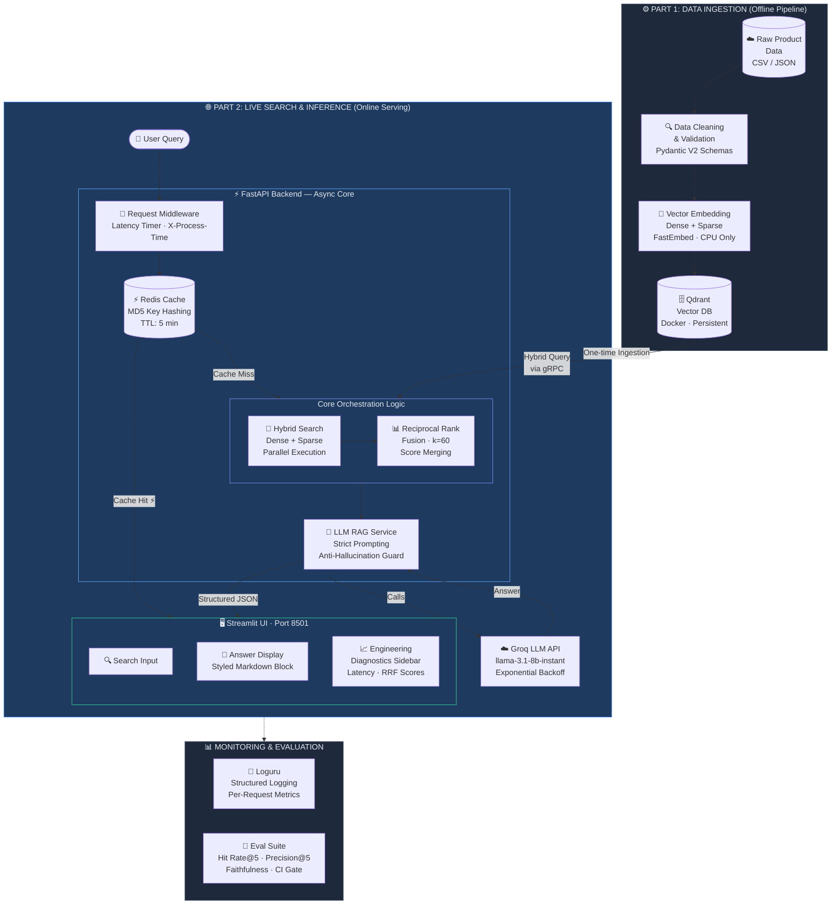

# E-Commerce Semantic Search & RAG Pipeline

A production-grade hybrid search and Retrieval-Augmented Generation (RAG) engine for e-commerce product discovery. Built with FastAPI, Qdrant, FastEmbed, Groq LLM, Redis, and Streamlit — fully containerized with Docker Compose.

---

## System Architecture & Motivation

### Why Naive RAG Fails in Production

Most RAG tutorials wire a single dense vector search to an LLM and call it done. This breaks in e-commerce for two reasons:

1. **SKU mismatch** — Dense embeddings capture semantic similarity, not exact token matches. A query for "Sony WH-1000XM5" may semantically retrieve "Bose QuietComfort 45" because they are conceptually similar, but the user wanted a specific SKU. Pure semantic search fails precision-critical queries.

2. **Keyword blindness** — Sparse retrieval (BM25/SPLADE) solves SKU matching but fails on abstract queries like "comfortable headphones for long flights" where no keyword overlap exists.

This system solves both by running dense and sparse retrieval in parallel and fusing results using Reciprocal Rank Fusion (RRF) — balancing semantic understanding with keyword precision.

### Architecture Diagram


---

## Core Engineering Decisions

### 1. FastAPI Async/Await
FastAPI with async endpoints allows the server to handle multiple concurrent requests without blocking. During LLM API calls (200-800ms latency), the event loop serves other requests rather than sitting idle. Critical for production throughput under concurrent user load.

### 2. Pydantic V2 Validation
All incoming product records pass through strict Pydantic V2 schemas before touching the vector database. Negative prices, missing fields, and type mismatches are caught and logged at the ingestion boundary — not silently corrupting the index. Per-record error isolation means one bad row never crashes the pipeline.

### 3. Reciprocal Rank Fusion (RRF)
RRF merges dense and sparse retrieval rankings using the formula:

$$
RRF\_Score(d) = \sum_m \frac{1}{k + r_m(d)}
$$

Where `k=60` is a smoothing constant and `r_m(d)` is the rank of document `d` in retrieval model `m`. This prevents any single retrieval method from dominating and produces more robust rankings than score-based fusion (which fails when dense and sparse scores are on different scales).

### 4. Two-Tier Caching Strategy
- **Redis cache** with 5-minute TTL intercepts repeated queries before they hit Qdrant or the LLM
- Cache keys use MD5 hashes of normalized (lowercased, stripped) query strings — "Waterproof Bag" and "waterproof bag" hit the same cache entry
- Demonstrated cache hit latency: **4-5ms** vs 500-800ms for full pipeline
- Protects Groq free tier rate limits and eliminates redundant vector lookups

### 5. CPU-Only Embedding (FastEmbed)
FastEmbed runs ONNX-optimized models locally with zero GPU requirement:
- Dense: `BAAI/bge-small-en-v1.5` (384-dim, ~67MB)
- Sparse: `Qdrant/bm25` (statistical, near-zero cost)

Both models are loaded once at startup as app-level singletons — not per-request — eliminating the 1000ms+ cold-start penalty on repeated queries.

---

## Tech Stack

| Layer | Technology |
|---|---|
| Vector Database | Qdrant (Docker) |
| Dense Embeddings | BAAI/bge-small-en-v1.5 via FastEmbed |
| Sparse Embeddings | BM25 via FastEmbed |
| Fusion Algorithm | Reciprocal Rank Fusion (RRF, k=60) |
| Backend API | FastAPI (async) + Uvicorn |
| LLM | Groq llama-3.1-8b-instant |
| Cache | Redis 7 (Docker) |
| Frontend | Streamlit |
| Validation | Pydantic V2 |
| Containerization | Docker Compose |

---

## Local Setup & Launch

### Prerequisites
- Docker Desktop
- Python 3.11+
- Groq API key (free at https://console.groq.com)

### 1. Clone the repository
```bash
git clone https://github.com/tarun-rai21/ecommerce-rag-engine.git
cd ecommerce-rag-engine
```

### 2. Configure environment
```bash
cp .env.example .env
# Edit .env and add your GROQ_API_KEY
```

### 3. Launch the full stack
```bash
docker-compose up --build -d
```

This spins up 4 containers: Qdrant, Redis, FastAPI backend, Streamlit frontend.

### 4. Ingest product data
```bash
pip install -r requirements.txt
python -m src.ingestion.ingest
```

### 5. Access the application
- **Frontend UI**: http://localhost:8501
- **Backend API docs**: http://localhost:8000/docs
- **Qdrant dashboard**: http://localhost:6333/dashboard

---

## API Reference

### POST /api/v1/search
Hybrid semantic + keyword search. Returns ranked products with RRF scores.

```json
Request:  {"q": "waterproof hiking bag", "limit": 5}
Response: {"results": [...], "latency_ms": 45.2}
```

### POST /api/v1/ask
Full RAG pipeline. Returns LLM-generated answer with diagnostic metadata.

```json
Request:  {"q": "waterproof hiking bag", "limit": 5}
Response: {
  "answer": "The Rugged Camping Backpack...",
  "source": "llm",
  "retrieved_products": [...],
  "timing": {
    "cache_lookup_ms": 1.2,
    "search_ms": 22.4,
    "llm_ms": 210.5,
    "total_ms": 234.1
  }
}
```

---

## Evaluation Results

Run the offline evaluation suite:

```bash
python src/evaluation/eval.py
```

### Latest Results (39 products, 15 test queries)

| Metric | Score |
|---|---|
| Hit Rate @ 5 | 1.0000 |
| Precision @ 5 | 0.2800 |
| Faithfulness | 0.8000 |
| CI/CD Gate | ✓ PASSED |

**Hit Rate@5 = 1.00** means every query retrieved at least one correct product in the top 5.

**Precision@5 = 0.28** reflects that most queries have 1-2 relevant products in a 39-item catalog — mathematically expected given catalog size.

**Faithfulness = 0.80** means the LLM grounded 80% of responses in retrieved product data without hallucination.

### CI/CD Gate
The evaluation script exits with code `1` if Hit Rate@5 falls below `0.70`, blocking deployment of retrieval regressions.

---

## Project Structure
```bash
ecommerce-rag-engine/

├── config/

│   └── settings.py           # Pydantic-settings config management

├── data/

│   └── raw/

│       └── sample_products.json

├── database/

│   ├── qdrant_storage/       # Qdrant vector DB persistence

│   └── cache_storage/        # Redis persistence

├── src/

│   ├── ingestion/

│   │   ├── schemas.py        # Pydantic V2 product validation

│   │   ├── embedder.py       # FastEmbed dense + sparse

│   │   └── ingest.py         # Batch ingestion pipeline

│   ├── backend/

│   │   ├── main.py           # FastAPI app + lifespan

│   │   ├── api/v1/

│   │   │   ├── endpoints.py  # /search and /ask routes

│   │   │   └── router.py

│   │   ├── models/

│   │   │   └── api_schemas.py

│   │   └── services/

│   │       ├── search.py     # Hybrid search + RRF

│   │       ├── cache.py      # Redis cache service

│   │       └── llm.py        # Groq LLM service

│   ├── frontend/

│   │   ├── app.py            # Streamlit UI

│   │   └── components/

│   │       └── diagnostics.py

│   └── evaluation/

│       ├── ground_truth.json

│       └── eval.py           # Precision + Hit Rate + Faithfulness

├── Dockerfile.backend

├── Dockerfile.frontend

├── docker-compose.yml

└── requirements.txt
```

---

## Known Limitations & Future Work

- **Catalog size**: 39 products is a demonstration dataset. Production deployment would require a larger catalog and re-evaluation of Precision@K thresholds.
- **Evaluation depth**: Current faithfulness metric is keyword-based. RAGAS framework with LLM-as-judge would provide deeper semantic faithfulness scoring at scale.
- **Embedding model**: `bge-small-en-v1.5` is optimized for speed. `bge-large-en-v1.5` or `text-embedding-3-large` would improve semantic retrieval quality at higher compute cost.
- **Sparse model**: BM25 is statistical. Upgrading to SPLADE neural sparse model would improve keyword expansion for ambiguous queries.

