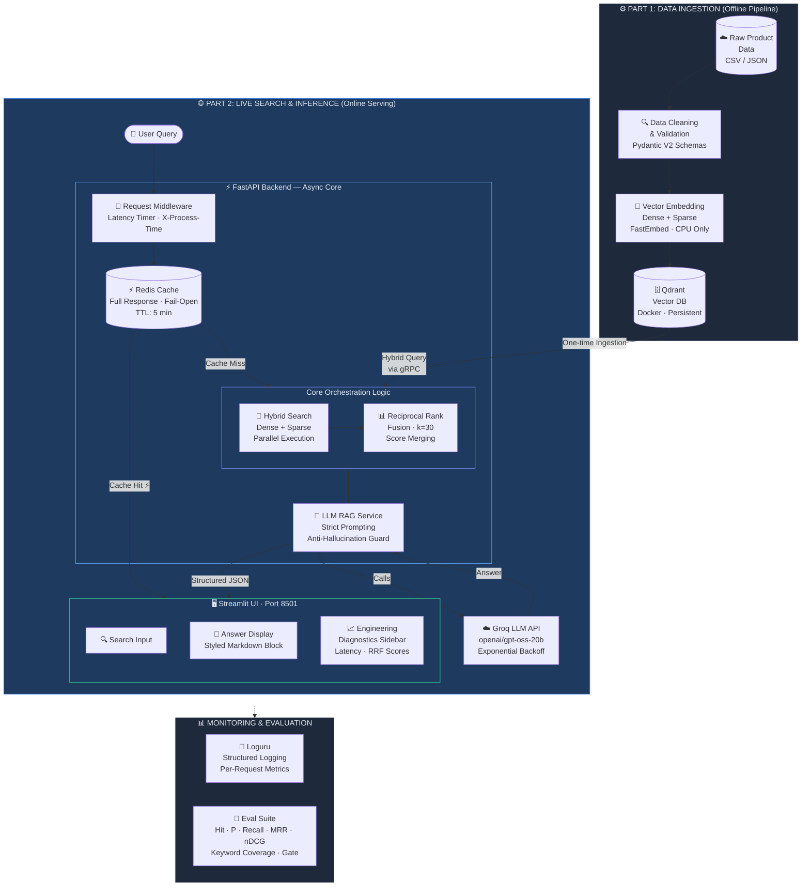

# E-Commerce Semantic Search & RAG Pipeline

A production-grade hybrid search and Retrieval-Augmented Generation (RAG) engine for e-commerce product discovery. Built with FastAPI, Qdrant, FastEmbed, Groq LLM, Redis, and Streamlit — fully containerized with Docker Compose.

---

## System Architecture & Motivation

### Why Naive RAG Fails in Production

Most RAG tutorials wire a single dense vector search to an LLM and call it done. This breaks in e-commerce for two reasons:

1. **SKU mismatch** — Dense embeddings capture semantic similarity, not exact token matches. A query for "Sony WH-1000XM5" may semantically retrieve "Bose QuietComfort 45" because they are conceptually similar, but the user wanted a specific SKU. Pure semantic search fails precision-critical queries.

2. **Keyword blindness** — Sparse retrieval (BM25/SPLADE) solves SKU matching but fails on abstract queries like "comfortable headphones for long flights" where no keyword overlap exists.

This system solves both by running dense and sparse retrieval in parallel and fusing results using Reciprocal Rank Fusion (RRF) — balancing semantic understanding with keyword precision.

**Measured result:** on held-out queries from the human-labelled Wayfair WANDS benchmark (42,994 products), hybrid retrieval scores **nDCG@10 = 0.728 vs 0.676 for dense-only** (+0.052, 95% CI [+0.035, +0.069]). See [Evaluation Results](#evaluation-results).

### Dataset: Wayfair WANDS
The catalog is [WANDS](https://github.com/wayfair/WANDS) (Wayfair ANnotation DataSet, MIT licence): **42,994 furniture and home products, 480 real search queries and 233,448 human relevance judgments** (Exact / Partial / Irrelevant). Having judgments written by someone other than the system's author is what makes the evaluation meaningful.

> **Prices are synthetic.** WANDS publishes no prices. Each product gets a deterministic synthetic price (log-normal around a per-category median, seeded by product id) so price filtering can be demonstrated. Every record is flagged `price_is_synthetic: true`, and the UI says so.

### Architecture Diagram


---

## Core Engineering Decisions

### 1. FastAPI Async/Await
FastAPI with async endpoints allows the server to handle multiple concurrent requests without blocking. During LLM API calls (200-800ms latency), the event loop serves other requests rather than sitting idle. Critical for production throughput under concurrent user load.

### 2. Pydantic V2 Validation
All incoming product records pass through strict Pydantic V2 schemas before touching the vector database. Negative prices, missing fields, and type mismatches are caught and logged at the ingestion boundary — not silently corrupting the index. Per-record error isolation means one bad row never crashes the pipeline.

### 3. Reciprocal Rank Fusion (RRF)
RRF merges dense and sparse retrieval rankings using the formula:

$$
RRF\_Score(d) = \sum_m \frac{1}{k + r_m(d)}
$$

Where `k` is a smoothing constant and `r_m(d)` is the 1-based rank of document `d` in retrieval model `m`. Fusion runs server-side in Qdrant (`RrfQuery(rrf=Rrf(k=30))` over two `Prefetch` legs of 100 candidates each). A client-side implementation with the same `k` is available via `USE_NATIVE_FUSION=false`, and a test asserts both paths rank identically.

Fusing ranks instead of scores avoids calibrating cosine similarity against BM25 scores, which live on different scales. `k` sets the trade-off between *agreement* and *top rank*: with a small `k` (Qdrant's default is 2) a document ranked 1st by one retriever ties with one ranked 4th by both; with a large `k` the document both retrievers agree on wins.

**Tuning (dev split only).** A 4×3 grid over `k ∈ {10, 30, 60, 100}` and candidates per leg `∈ {20, 50, 100}` was scored on the dev queries; `k=30`, 100 candidates had the best nDCG@10. Nearly all of the gain came from the candidate count (20 → 50: about +0.015 nDCG@10 at every `k`); differences between `k` values were within noise (< 0.005). On the untouched test split, the tuned setting scores 0.728 vs 0.701 for the common default (`k=60`, 20 candidates).

> **BM25 needs Qdrant's IDF modifier.** FastEmbed's `Qdrant/bm25` model stores only the saturated term-frequency part of BM25. The IDF part is computed by Qdrant from collection statistics, and only when the sparse index is created with `modifier=Modifier.IDF`. Queries are encoded with `query_embed` (weight 1.0 per token). Ingestion refuses to reuse a collection whose sparse index lacks the modifier.

### 4. Response Caching (Redis)
- Redis with a 5-minute TTL caches the **full `/ask` response** (answer + retrieved products), so a cache hit returns exactly what the original request did
- Keys: `rag:<cache version>:ask:limit=<n>:<md5(normalized query)>`. Normalization (lowercase, trimmed, whitespace collapsed) makes "Waterproof  Bag" and "waterproof bag" share an entry; the version prefix is bumped on re-index so stale answers are never served
- Only successful LLM answers are cached, never fallback messages
- **Fail-open with a circuit breaker:** each Redis call has a 250 ms budget; after a failure the cache is bypassed for 30 s, so an outage costs one timeout rather than one per request
- Measured locally: cache hit ≈ 1.5–11 ms end-to-end vs ≈ 300–950 ms for a full search + LLM request

### 5. Query Understanding & Hard Filters
Shoppers write constraints into the query: "grey area rug under $150", "desk lamp 4.5+ stars". `query_parser.py` turns them into structured filters and removes them from the text used for retrieval:

```
"grey area rug under $150"                    → text "grey area rug",     max_price 150
"coffee table between $200 and $400"          → text "coffee table",      min_price 200, max_price 400
"desk lamp 4.5+ stars"                        → text "desk lamp",         min_rating 4.5
```

- **Rules, not an LLM.** Price and rating constraints are numeric patterns, so rules are instant, free, deterministic and unit-testable, with no dependency on a rate-limited API. They're strict because a false positive silently hides good products. A number is a price only with a currency marker or directly after a price phrase, and never when followed by a unit ("48 inch vanity", "5 drawer dresser"). Positional words don't trigger ("twin **over** full bunk beds", "end table **between** recliners"). A test asserts that **none of the 480 real WANDS queries** produces a constraint.
- **Categories are not guessed from text.** A wrong category filter hides good results, and ranking already handles category meaning. Categories come from explicit facet filters (UI controls), populated from Qdrant's facet API (`GET /api/v1/facets`).
- **Pre-filtering, not post-filtering.** The Qdrant filter is applied inside each prefetch leg, so dense and BM25 each return their best *matching* candidates before fusion. Filtering after fusion would leave gaps (see the benchmark below).
- **Explicit filters override parsed ones** field by field, and the response reports `interpreted_query` and `applied_filters` so the UI can show what was searched. Filters are part of the cache key. The LLM is told which filters were applied, so it doesn't refuse with "I can't confirm the price".
- Products without a rating never match a rating filter: an unknown rating isn't evidence of a good one.

### 6. CPU-Only Embedding (FastEmbed)
FastEmbed runs ONNX-optimized models locally with zero GPU requirement:
- Dense: `BAAI/bge-small-en-v1.5` (384-dim, ~67MB)
- Sparse: `Qdrant/bm25` (statistical, near-zero cost)

Both models are loaded once at startup as app-level singletons — not per-request — eliminating the 1000ms+ cold-start penalty on repeated queries.

**Indexing cost and the embedding cache.** On a 4-core laptop CPU (Intel i5-8265U), the dense model embeds about 10 products/s, so the first full index of WANDS takes about an hour. Embeddings are cached on disk in SQLite, keyed by `(model, sha256(text))`, so an interrupted run resumes where it stopped and re-indexing unchanged products runs at about 430 products/s. The embedded text is compact by design: name, product class, category path, a few attributes (color, material, style, shape) and the first 300 characters of the description. The full description stays in the payload for the LLM.

---

## Tech Stack

| Layer | Technology |
|---|---|
| Vector Database | Qdrant (Docker) |
| Dense Embeddings | BAAI/bge-small-en-v1.5 via FastEmbed |
| Sparse Embeddings | BM25 via FastEmbed |
| Fusion Algorithm | Reciprocal Rank Fusion (RRF, k=30, 100 candidates per leg) |
| Dataset | Wayfair WANDS (42,994 products, 480 labelled queries) |
| Backend API | FastAPI (async) + Uvicorn |
| LLM | Groq `openai/gpt-oss-20b` (configurable via `LLM_MODEL`) |
| Cache | Redis 7.4 (Docker) |
| Frontend | Streamlit |
| Validation | Pydantic V2 |
| Containerization | Docker Compose |

---

## Local Setup & Launch

### Prerequisites
- Docker Desktop
- Python 3.11+
- Groq API key (free at https://console.groq.com)

### 1. Clone the repository
```bash
git clone https://github.com/tarun-rai21/ecommerce-rag-engine.git
cd ecommerce-rag-engine
```

### 2. Configure environment
```bash
cp .env.example .env
# Edit .env and add your GROQ_API_KEY
```

### 3. Launch the full stack
```bash
docker-compose up --build -d
```

This spins up 4 containers: Qdrant (v1.18.2), Redis (7.4.9), FastAPI backend, Streamlit frontend. Qdrant and Redis data live in named Docker volumes (`qdrant_data`, `redis_data`).

### 4. Download and ingest product data
```bash
pip install -r requirements.txt
python scripts/download_wands.py          # ~96 MB into data/wands/ (not committed)
python -m src.ingestion.ingest            # WANDS → collection "wands_products"
```
Options: `--dataset sample` (the original 39-product demo), `--collection <name>`, `--limit N`, `--recreate` (rebuild from scratch), `--no-cache`.

Ingestion validates every record, creates payload indexes on `category`, `product_class`, `price`, `rating` and `review_count`, and writes a JSON report to `reports/` (counts, cache reuse, rejection reasons). It refuses to reuse an existing collection whose sparse index lacks the IDF modifier (`--recreate` rebuilds it). The first full run takes about an hour on a laptop CPU; later runs reuse the embedding cache.

### Run the tests
```bash
pip install -r requirements-dev.txt
pytest
```
The suite uses Qdrant's local mode and the real embedding models, so it does not need Docker.

### 5. Access the application
- **Frontend UI**: http://localhost:8501
- **Backend API docs**: http://localhost:8000/docs
- **Qdrant dashboard**: http://localhost:6333/dashboard

---

## API Reference

### POST /api/v1/search
Hybrid semantic + keyword search. Returns ranked products with RRF scores.

```json
Request:  {"q": "grey area rug under $150", "limit": 5,
           "filters": {"categories": ["Rugs"], "min_rating": 4},   // optional, overrides parsed values
           "parse_filters": true}                                  // optional, default true
Response: {"results": [...], "latency_ms": 45.2,
           "interpreted_query": "grey area rug",
           "applied_filters": {"min_price": null, "max_price": 150.0, "categories": ["Rugs"], "min_rating": 4.0}}
```

### GET /api/v1/facets?key=category
Distinct values with counts for filter dropdowns (`key`: `category` or `product_class`).

```json
Response: {"key": "category", "values": [{"value": "Furniture", "count": 16039}, ...]}
```

### POST /api/v1/ask
Full RAG pipeline. Returns LLM-generated answer with diagnostic metadata.

```json
Request:  {"q": "mid-century modern coffee table", "limit": 5}     // limit: 1–20
Response: {
  "answer": "Here are mid-century modern coffee tables from the catalog...",
  "source": "llm",          // llm | cache | no_results | llm_error
  "retrieved_products": [...],
  "timing": {
    "cache_lookup_ms": 1.2,
    "search_ms": 22.4,
    "llm_ms": 210.5,
    "total_ms": 234.1
  },
  "interpreted_query": "mid-century modern coffee table",
  "applied_filters": {...}
}
```
`/ask` accepts the same `filters` and `parse_filters` fields as `/search`.

---

## Evaluation Results

### Retrieval on WANDS (primary benchmark)

```bash
python -m src.evaluation.retrieval_eval --split dev    # tuning
python -m src.evaluation.retrieval_eval --split test   # reporting (run once per frozen config)
```

The script runs the production `ProductSearchService` in-process (no HTTP, no cache, no LLM) in three modes (dense only, BM25 only, hybrid) and scores each against the WANDS human judgments. Queries are split by a hash of the query id into **dev (179 queries, tuning)** and **test (301 queries, reporting)**. Confidence intervals are 95% bootstrap intervals over queries (2,000 resamples); comparisons against dense are paired (same queries, same resamples).

**Test split, 301 queries, frozen config (k=30, 100 candidates per leg):**

| Mode | nDCG@10 | Recall@100 | MRR@10 | P@10 | judged@10 | Search p50 / p95 |
|---|---|---|---|---|---|---|
| Dense only | 0.676 [0.642, 0.710] | 0.629 [0.583, 0.669] | 0.657 [0.605, 0.708] | 0.451 [0.404, 0.500] | 0.79 | 15 / 33 ms |
| BM25 only | 0.659 [0.622, 0.696] | 0.659 [0.612, 0.701] | 0.723 [0.672, 0.771] | 0.460 [0.414, 0.506] | 0.79 | 8 / 11 ms |
| **Hybrid (RRF)** | **0.728 [0.695, 0.760]** | **0.675 [0.628, 0.715]** | **0.739 [0.689, 0.785]** | **0.492 [0.443, 0.539]** | 0.85 | 15 / 24 ms |

Paired difference vs dense: **hybrid nDCG@10 +0.052 [+0.036, +0.068]**, Recall@100 +0.046 [+0.024, +0.071], both significant. BM25 alone vs dense: nDCG@10 −0.017 [−0.045, +0.008] (not significant). For reference, hybrid with the untuned default (`k=60`, 20 candidates) scored nDCG@10 0.701 on test (measured before the tie-breaking fix below; results moved by at most ±0.002).

**Reproducibility.** RRF often produces exact score ties (a product ranked *r*-th by dense alone scores the same as one ranked *r*-th by BM25 alone), and Qdrant returns tied points in an order that varies between runs. That shifted nDCG@10 by up to ±0.002 between identical runs. Both fusion paths and the single-retriever baselines now break ties by product id (fetching a few extra results so a tie at the cut-off can't change the set). Two consecutive test runs now produce identical top-10s for every query in every mode. Latency columns vary with machine load and are indicative only.

**How the metrics are defined:**
- **nDCG@10** (primary) uses graded gains: Exact = 2, Partial = 1.
- **Recall@100, MRR@10 and P@10** treat only *Exact* as relevant, so they use the 237 test queries with at least one Exact judgment.
- **Unjudged products count as irrelevant**, the standard convention for pooled judgments. **judged@10** is the share of the top 10 that has any judgment: around 80% here, so absolute scores are somewhat pessimistic for every mode.
- **Duplicate judgments:** 1,467 (query, product) pairs are judged more than once and 14 disagree; the highest label is kept.
- **Top-10 vs depth-100:** top-10 metrics come from a `limit=10` search with the production settings; Recall@100 comes from a separate `limit=100` search.
- **Search latency** excludes query embedding and is measured on a laptop with Qdrant in Docker.

### Price-constrained retrieval (filters)

```bash
python -m src.evaluation.filter_eval --split test
```

WANDS queries never state a budget, so the benchmark adds one. For each test query with at least one Exact judgment, the budget **X = median synthetic price of its Exact products** (about half of them fit), and the query becomes "*query* under $X". A product counts as relevant only if it's judged relevant **and** priced ≤ X. All three systems use the same hybrid retrieval:

| System (237 test queries) | nDCG@10 (budget-aware) | Over-budget results | Slots filled (of 10) |
|---|---|---|---|
| No parsing: search the raw text, no filter (previous behaviour) | 0.297 [0.268, 0.328] | 50.5% | 10.0 |
| Post-filter: parse, search, then drop over-budget results | 0.388 [0.352, 0.423] | 0.0% | 4.9 |
| **Pre-filter: parse, filter inside each prefetch (this system)** | **0.554 [0.506, 0.599]** | **0.0%** | **10.0** |

Pre-filtering vs no parsing: **+0.257 nDCG@10** [+0.227, +0.288]; vs post-filtering: **+0.165** [+0.144, +0.189]. Without parsing, half of what's shown is over budget. Post-filtering never violates the budget but leaves half the page empty. Prices are synthetic, so this measures filter mechanics, not real-world price behaviour.

### Answer quality

```bash
python -m src.evaluation.generation_eval
python -m src.evaluation.generation_eval --calibrate src/evaluation/judge_labels.csv
```

100 queries go through the production path (parsing, hybrid search, context, generator): 50 WANDS dev queries, 20 more with a budget appended, and 30 hand-written queries for products a home-goods catalog doesn't stock, each checked against the catalog's top results. An LLM judge from a different model family (`qwen/qwen3.8-27b`) audits each answer against its context, and rule-based checks cover refusals, prices and wording. 95% bootstrap CIs.

| Metric | Result |
|---|---|
| Correct refusal, out-of-catalog | 100% (30/30) |
| Refusal on in-catalog queries | 15.7% [7.1%, 24.3%] (11/70) |
| ...when an Exact product was among the 5 retrieved | 3.8% [0.0%, 9.4%] (2/53) |
| Claims the judge found supported | 99.1% [98.5%, 99.7%] (1,348 of 1,361) |
| Answers with every claim supported (judge) | 84.7% [74.6%, 93.2%]; see calibration below |
| Relevance (judge, 1-5) | 4.90 [4.80, 4.98] |
| Answers quoting a price not in the context | 0% (0/59) |
| Answers claiming to cover the whole catalog | 1.7% (1/59) |

Nine of the 11 in-catalog refusals had no Exact product in the context, so most trace back to retrieval, or to a requested detail such as a brand or finish that wasn't there. Refusing is defensible in those cases.

**Prompt iteration.** The first version told shoppers "these are the only products in our catalog" in 25% of answers (15/59), although the model sees 5 products. Two prompt revisions brought this to 1.7%, a paired change of −22 points [−36, −10], with no significant change in supported claims (−0.2 points [−1.0, +0.8]). Answers grew about 20% longer. The same 100 queries were used to develop the prompt and report these results, and the WANDS queries all come from the dev split, so treat them as development numbers rather than a held-out estimate.

**Judge calibration: the judge is lenient.** A second AI reviewer (Claude Opus 5.5, not a human) labelled 30 answers against their context, with the sheet in `src/evaluation/judge_labels.csv`:

| | |
|---|---|
| Every claim supported? | 77% agreement, Cohen's κ 0.46 |
| Rated fully supported | Reviewer 60%, judge 83% |
| Relevance | 87% exact, 100% within 1 point |
| Disagreements on support | 7, all where the reviewer found a problem the judge passed |

Read 84.7% as an upper estimate. The misses are mostly small embellishments ("classic design", a product name read as a material). Limits: the reviewer is an AI, it had already seen the judge's flagged claims for this run, so agreement may be inflated, it marked an answer down for a single unsupported word, and 30 answers is a small sample. A human review is still needed before calling the judge human-validated.

Every LLM call is cached by its full request in `.cache/llm_calls.sqlite`, so an unchanged re-run is free. A cold run takes about 1.5 hours on Groq's free tier.

### Cross-encoder reranking: tested, not enabled

A cross-encoder reranker (`src/backend/services/rerank.py`) can re-score the top 20 hybrid results by reading the query and product text together. It runs under a time budget and falls back to the RRF order on timeout or error. It's **off by default** (`RERANK_ENABLED=false`) because, on the dev split, no CPU-feasible model cleared the bar set before the experiment: a gain over plain hybrid that is statistically significant *and* at least +0.010 nDCG@10.

| Model (top 20 re-scored) | nDCG@10 vs hybrid (dev, 179 queries) | Added latency p50 / p95 |
|---|---|---|
| `Xenova/ms-marco-MiniLM-L-6-v2` | +0.012 [−0.003, +0.028] | +0.78 s / +1.1 s |
| `jinaai/jina-reranker-v1-tiny-en` | +0.013 [−0.003, +0.029] | +0.64 s / +0.9 s |
| `jinaai/jina-reranker-v1-turbo-en` | +0.013 [−0.002, +0.030] | +0.99 s / +1.5 s |

The gain is consistent across models but too small to separate from noise on 179 queries, and it would multiply search latency by about 40× on this CPU. `BAAI/bge-reranker-base` (3.1 pairs/s here, about 6.5 s for 20 candidates) was ruled out on speed before any accuracy run. These rerankers were trained on web passages (MS MARCO), not product listings, which may limit transfer. A domain-tuned reranker or GPU serving would change the trade-off; to try it, set `RERANK_ENABLED=true` and `RERANK_MODEL`, and evaluate with `--modes hybrid hybrid_rerank --baseline hybrid`. The test split wasn't used for any reranker decision.

### Smoke evaluation (original 39-product demo catalog)

```bash
python -m src.ingestion.ingest --dataset sample --collection ecommerce_products
# start the backend with COLLECTION_NAME=ecommerce_products, then:
python -m src.evaluation.eval                 # retrieval + answers over HTTP
python -m src.evaluation.eval --skip-answers   # retrieval only (no LLM calls)
```

This end-to-end check calls the running API. Retrieval metrics come from `/search` (no cache, no LLM); answer metrics come from `/ask`. Each run writes a JSON report to `reports/`. The results below come from the Phase 0 configuration (`k=60`, 20 candidates per leg).

#### Latest Results (39 products, 15 test queries, k=5)

| Metric | Score | Notes |
|---|---|---|
| Hit Rate @ 5 | 1.0000 | |
| Precision @ 5 | 0.2533 | Ceiling on this ground truth is 0.2933 (only 22 relevant labels across 75 slots) |
| Recall @ 5 | 0.9222 | |
| MRR @ 5 | 1.0000 | A relevant product is ranked first for every query |
| nDCG @ 5 | 0.9429 | Binary relevance |
| Keyword coverage | 0.8667 | Share of expected keywords in the answer (`openai/gpt-oss-20b`); varies slightly between runs |

Retrieval metrics were identical across repeated runs, including runs served entirely from cache.

**How to read these numbers honestly:**
- **This set is saturated.** Dense-only retrieval also reaches Hit@5 = 1.0, so these 15 queries can't show whether hybrid retrieval beats a single retriever; that's what the WANDS benchmark above is for.
- **Keyword coverage is not faithfulness.** It checks whether expected words appear in the answer, not whether the answer is supported by the retrieved products.

#### Evaluation Gate
The script exits with code `1` if Hit Rate@5 falls below `0.70` or any retrieval request fails. It's meant to be run in CI; no CI workflow is set up yet.

---

## Project Structure
```bash
ecommerce-rag-engine/

├── config/

│   └── settings.py           # Pydantic-settings config management

├── data/

│   ├── raw/

│   │   └── sample_products.json   # 39-product demo catalog

│   └── wands/                # WANDS CSVs (downloaded, not committed)

├── scripts/

│   └── download_wands.py

├── src/

│   ├── ingestion/

│   │   ├── loaders/          # sample + WANDS loaders

│   │   ├── schemas.py        # Pydantic V2 product validation + embedded text

│   │   ├── pricing.py        # Deterministic synthetic prices (disclosed)

│   │   ├── embedder.py       # FastEmbed dense + sparse

│   │   ├── embedding_cache.py  # SQLite cache keyed by text hash (resumable)

│   │   └── ingest.py         # Batch ingestion pipeline + payload indexes + report

│   ├── backend/

│   │   ├── main.py           # FastAPI app + lifespan

│   │   ├── api/v1/

│   │   │   ├── endpoints.py  # /search and /ask routes

│   │   │   └── router.py

│   │   ├── models/

│   │   │   └── api_schemas.py

│   │   └── services/

│   │       ├── search.py     # Hybrid search + RRF + payload filters + facets

│   │       ├── query_parser.py  # "under $300", "4+ stars" → SearchFilters

│   │       ├── rerank.py     # Optional cross-encoder reranker (off by default)

│   │       ├── cache.py      # Redis cache service

│   │       └── llm.py        # Groq LLM service

│   ├── frontend/

│   │   ├── app.py            # Streamlit UI

│   │   └── components/

│   │       └── diagnostics.py

│   └── evaluation/

│       ├── datasets.py       # WANDS judgments + fixed dev/test split

│       ├── metrics.py        # Hit@K, P@K, Recall@K, MRR, nDCG, keyword coverage

│       ├── stats.py          # Bootstrap CIs + paired differences

│       ├── retrieval_eval.py # WANDS benchmark: dense vs BM25 vs hybrid

│       ├── filter_eval.py    # Price-constrained benchmark: no parsing vs post- vs pre-filter
│       ├── generation_eval.py # Answer quality: refusals, faithfulness, relevance, calibration
│       ├── judge.py          # LLM judge, rule-based answer checks, cached LLM calls
│       ├── out_of_catalog.json # Queries the catalog can't answer
│       ├── judge_labels.csv  # Reviewer labels used to calibrate the judge

│       ├── ground_truth.json # 15 queries for the demo catalog

│       └── eval.py           # HTTP smoke evaluation + gate

├── tests/                    # pytest: ingestion, search, API, cache, metrics, LLM

├── Dockerfile.backend

├── Dockerfile.frontend

├── docker-compose.yml

├── requirements.txt

└── requirements-dev.txt
```

---

## Known Limitations & Future Work

- **Synthetic prices**: WANDS has no prices; the ones shown are generated and must not be read as real.
- **Answer quality has no human validation yet**: the judge was calibrated against an AI reviewer that wasn't fully blind, on 30 answers. It also misses subtle embellishments, so its faithfulness scores are upper estimates.
- **No reranker**: cross-encoder reranking was evaluated and left off (gain not significant on dev, about +0.7–1.0 s per query on CPU); see above.
- **Over-strict refusals**: the prompt tells the model to refuse when the context lacks a requested detail. For example, "grey area rug 8x10" retrieves grey rugs, but size isn't among the attributes passed to the LLM, so it refuses.
- **Constraint parsing covers price and rating only**, in English patterns. Categories aren't inferred from text (by design), and other attributes ("8x10", "walnut") are left to ranking rather than enforced as filters.
- **Incomplete judgments**: about 20% of top-10 results have no WANDS judgment and count as irrelevant, so absolute scores are pessimistic.
- **Embedding model**: `bge-small-en-v1.5` is optimized for speed. `bge-large-en-v1.5` or `text-embedding-3-large` would improve semantic retrieval quality at higher compute cost.
- **Sparse model**: BM25 is statistical. Upgrading to SPLADE neural sparse model would improve keyword expansion for ambiguous queries.

